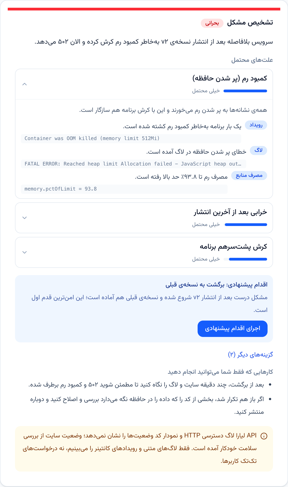
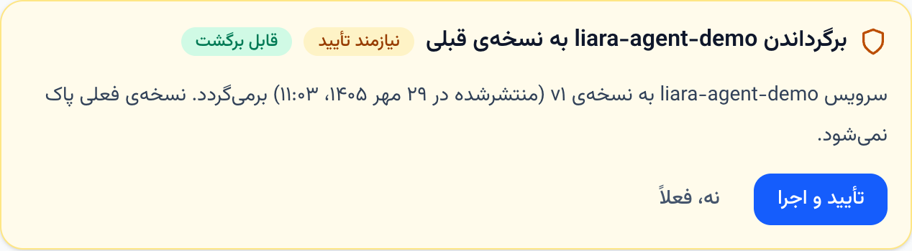
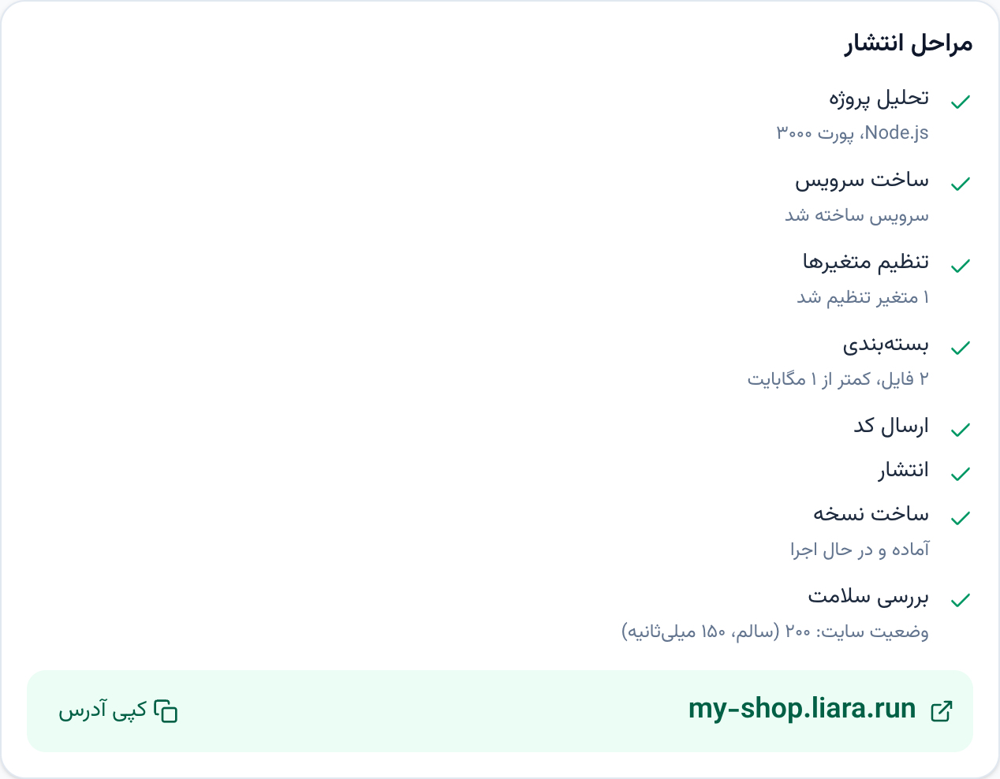
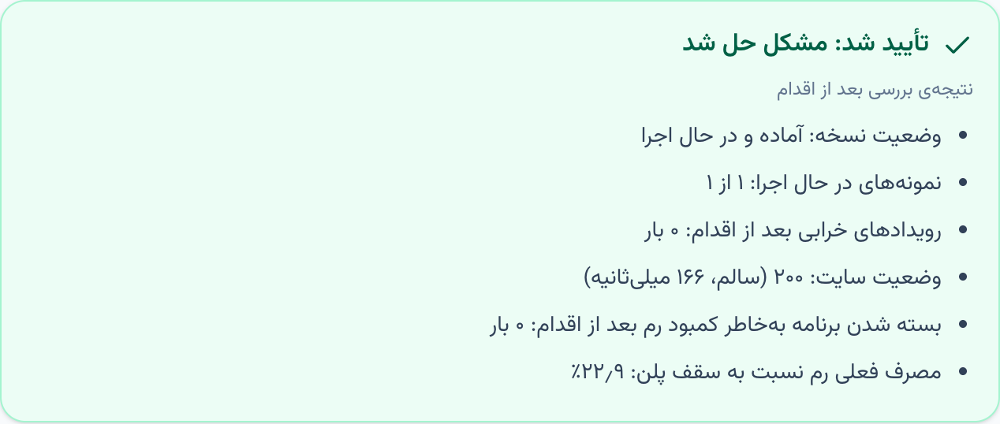

# همکار فنی لیارا (liara-agent)

> **TL;DR (English).** An AI DevOps/SRE co-worker for [Liara](https://liara.ir), the Iranian PaaS. It deploys a
> developer's project with minimal questions, watches the app, diagnoses incidents (HTTP 500s, slowness, crashes,
> OOM, failed builds) from Liara events, logs and metrics with ranked, evidence-backed causes, proposes one fix,
> asks before anything risky, runs it, and **verifies** that it worked before saying "fixed". One tool registry
> (36 tools over Liara's official API) powers both a Persian, RTL Next.js chat and an MCP server for Claude
> Desktop / Cursor. Risk tiers (0 auto · 1 confirm · 2 confirm + type the app name) are enforced in code, not in
> the prompt. Stack: TypeScript, Next.js 15, Vercel AI SDK, Zod, SQLite, MCP SDK, Vitest — no agent framework.
> Run: `cp .env.example .env` → add `LIARA_API_TOKEN` + an LLM key → `npm install` → `npm run dev`.

---

## ۱. چی ساختیم

یک همکار فنی هوشمند برای برنامه‌نویسی که کدش را دارد ولی با استقرار، دامنه و لاگ آشنا نیست. پروژه را می‌گیرد،
پلن مناسب و هزینه‌اش را پیشنهاد می‌دهد و روی لیارا منتشر می‌کند؛ سرویس را زیر نظر دارد و وقتی سایت کند شد یا خطا
داد، علت را با شاهد (رویداد، لاگ، مصرف منابع) پیدا می‌کند، راه‌حل می‌دهد، با اجازه‌ی شما اجرا می‌کند و بعد
**بررسی می‌کند که واقعاً درست شده باشد**.

- 🎬 ویدیوی دمو: _(لینک بعد از ضبط اضافه می‌شود)_
- همین ابزارها از طریق MCP در Claude Desktop و Cursor هم در دسترس‌اند.



> تصویرهای این صفحه با `npm run shots` گرفته شده‌اند (روی شبیه‌ساز؛ همین دستور روی حساب واقعی هم کار می‌کند).

---

## ۲. معماری

```
┌─────────────────────────────────────────────────────────────────────┐
│  Next.js App (app/) — چت فارسی و راست‌به‌چپ                         │
│   کارت تشخیص · کارت تأیید · مراحل انتشار · نوار بررسی · بنر هشدار    │
│   /api/chat (SSE) · /api/events (SSE + replay) · /api/approve · …    │
└───────────────┬─────────────────────────────────────────────────────┘
                │ رویدادهای تایپ‌شده (src/events.ts) روی SSE
┌───────────────▼─────────────────────────────────────────────────────┐
│  Agent Core (src/agent/)                                            │
│   providers  → openai | gemini | openrouter (Vercel AI SDK)         │
│   loop       → حلقه‌ی فراخوانی ابزار + رویدادها                      │
│   policy     → دروازه‌ی ریسک: ۰ خودکار · ۱ تأیید · ۲ تأیید + تایپ نام │
│   evidence   → خوشه‌بندی لاگ، خلاصه‌ی متریک، نرمال‌سازی رویداد       │
│   playbooks  → ۱۵ سناریوی حادثه (YAML) + موتور قاعده                 │
│   diagnosis  → خروجی ساختاریافته (Zod) برای کارت تشخیص              │
│   verify     → اقدام → صبر → بررسی دوباره → گزارش                    │
│   deploy · domain · watcher · memory (SQLite)                       │
└───────────────┬─────────────────────────────────────────────────────┘
                │ فراخوانی ابزار با نام
┌───────────────▼─────────────────────────────────────────────────────┐
│  Tool Registry (src/tools/) — یک منبع واحد برای وب و MCP            │
│   defineTool({ name, input(zod), risk, run, verify, consequencesFa })│
└───────┬───────────────────────────────────────────┬─────────────────┘
┌───────▼────────────────────┐           ┌──────────▼──────────────────┐
│ Liara API client           │           │ MCP server (src/mcp/)        │
│ fetch + zod + retry        │           │ همان ابزارها روی stdio       │
└───────┬────────────────────┘           └─────────────────────────────┘
        │ HTTPS (Bearer token)
   https://api.liara.ir
```

- **رجیستری ابزار:** هر کار (خواندن لاگ، ری‌استارت، انتشار، دامنه…) یک ابزار با ورودی Zod، سطح ریسک و تابع
  `verify` است. چت وب و سرور MCP دقیقاً از همین ۳۶ ابزار استفاده می‌کنند.
- **دروازه‌ی ریسک (policy):** کد، نه پرامپت، تصمیم می‌گیرد چه چیزی تأیید لازم دارد؛ مدل نمی‌تواند از آن رد شود.
  هر اقدام اجراشده در جدول `audit` ثبت می‌شود (مقدار متغیرهای محرمانه پوشانده می‌شود).
- **بسته‌ی شواهد (evidence packet):** برای عیب‌یابی، رویدادها، لاگ‌ها، متریک‌ها، نسخه‌ها، نمونه‌ها و پاسخ واقعی سایت
  یک‌جا و موازی جمع و خلاصه می‌شوند (حداکثر ۲۰ کیلوبایت) و مدل یک بار روی آن استدلال می‌کند.
- **پلی‌بوک‌ها:** ۱۵ سناریوی حادثه (کمبود رم، کرش پشت‌سرهم، خطای بیلد، پورت اشتباه، متغیر محیطی جاافتاده، فایل‌سیستم فقط‌خواندنی، دیتابیس
  در دسترس نیست، دیسک پر، کندی، خرابی بعد از انتشار، …) به‌صورت داده. موتور قاعده بدون هوش مصنوعی هم کار می‌کند
  (اگر مدل در دسترس نباشد، تشخیص قاعده‌محور نشان داده می‌شود).
- **تشخیص ساختاریافته:** خروجی مدل با Zod اعتبارسنجی می‌شود: علت‌های رتبه‌بندی‌شده با احتمال و شاهد، یک اقدام
  پیشنهادی، کارهایی که فقط کاربر می‌تواند بکند و محدودیت‌ها.
- **حلقه‌ی بررسی (verify):** بعد از هر اقدام، صبر، دوباره سنجیدن (نمونه‌ها، رویدادهای کرش، پاسخ سایت، معیار
  پلی‌بوک) و فقط بعد از موفقیت «حل شد». بعد از ری‌استارت و تغییرهای مشابه، سه دقیقه بعد هم دوباره بررسی می‌شود تا
  اگر مشکل برگشت، هشدار داده شود.
- **پایشگر (watcher):** سرویس‌هایی که پایششان روشن است را دوره‌ای بررسی می‌کند و هشدار می‌دهد؛ وقتی سرویس چند
  بار پشت‌سرهم سالم بود، هشدار خودش بسته می‌شود.
- **MCP:** همان رجیستری با همان دروازه‌ی ریسک روی MCP؛ ابزارهای پرخطر بدون `confirm` اجرا نمی‌شوند
  ([docs/MCP.md](docs/MCP.md)).

---

## ۳. اتصال به APIهای لیارا

- **احراز هویت:** `Authorization: Bearer <LIARA_API_TOKEN>`؛ توکن فقط در `.env` است و فقط از `src/config.ts`
  خوانده می‌شود. هیچ‌وقت در پرامپت مدل، خروجی ابزار یا لاگ نمی‌آید (هدر `Authorization` در لاگ‌ها پوشانده می‌شود).
  حساب تیمی با `LIARA_TEAM_ID` (پارامتر `teamID`).
- **کلاینت:** `src/liara/client.ts` — `fetch` با timeout، تلاش دوباره برای خطاهای موقت، اعتبارسنجی پاسخ با Zod و
  خطاهای قابل‌فهم فارسی.

| کار | Endpoint |
|---|---|
| فهرست و جزئیات سرویس‌ها | `GET /v1/projects` · `GET /v1/projects/{app}` |
| ساخت و حذف سرویس | `POST /v1/projects` · `DELETE /v1/projects/{app}` |
| روشن/خاموش، ری‌استارت، تغییر پلن | `POST /v1/projects/{app}/actions/scale` · `…/actions/restart` · `POST /v1/projects/{app}/resize` |
| لاگ برنامه | `GET /v2/projects/{app}/logs` (در صورت نبود: `GET /v1/projects/{app}/logs`) |
| رویدادها (OOMKilled، BackOff، …) | `GET /v1/projects/{app}/events` |
| نمونه‌های در حال اجرا | `GET /v1/projects/{app}/applets` |
| مصرف منابع | `GET /v1/projects/{app}/metrics/{cpu\|memory}` · `…/metrics/summary` |
| انتشار و نسخه‌ها | `POST /v2/projects/{app}/sources` · `POST /v2/projects/{app}/releases` · `GET /v1/projects/{app}/releases` · `GET /v1/releases/{id}` · `GET /v2/releases/{id}/build-logs` |
| متغیرهای محیطی | `POST /v1/projects/update-envs` (کل مجموعه جایگزین می‌شود؛ ادغام سمت ما انجام می‌شود) |
| دامنه و SSL | `GET/POST /v1/domains` · `GET /v1/domains/{id}/check` · `POST /v1/domains/provision-ssl-certs` · `DELETE /v1/domains/{id}` |
| دیسک | `GET /v1/projects/{app}/disks` · `POST …/disks/{disk}/resize` |
| پلن‌ها و موجودی | `GET /v1/me` (کاتالوگ پلن‌ها) · `GET /v1/billing` |
| فرمان داخل کانتینر (ریسک ۲) | `wss://api.iran.liara.ir/v1/exec` |

**شکل واقعی پاسخ‌ها را از کجا فهمیدیم:** سه منبع، به ترتیب اعتماد: (۱) پاسخ واقعی API که `npm run probe` ضبط و
پاک‌سازی می‌کند (`fixtures/liara/*.json`)، (۲) سورس رسمی [liara-cli](https://github.com/liara-cloud/cli)،
(۳) مشخصات OpenAPI در developers.liara.ir. هر جا پاسخ واقعی با مستند فرق داشته باشد، پاسخ واقعی برنده است. تصمیم‌ها
و منبع هرکدام (`[probe]`، `[cli]`، `[spec]`) در [docs/API-NOTES.md](docs/API-NOTES.md) ثبت شده است.

---

## ۴. نحوه‌ی تعامل کاربر

کاربر فقط فارسی می‌نویسد؛ دستیار کارها را با ابزارها انجام می‌دهد و نتیجه را در کارت‌ها نشان می‌دهد:

| بخش | چه نشان می‌دهد |
|---|---|
| خط زمانی عملیات | هر ابزاری که اجرا شد، مدتش، خلاصه‌ی فارسی و «جزئیات» برای دیدن داده‌ی خام |
| کارت تشخیص | شدت مشکل، علت‌های محتمل با احتمال و شاهد، اقدام پیشنهادی، کارهای مخصوص کاربر، محدودیت‌ها |
| کارت تأیید | چه کاری، چرا، قابل برگشت یا نه، هزینه؛ برای ریسک ۲ باید نام سرویس تایپ شود |
| مراحل انتشار | تحلیل → ساخت سرویس → متغیرها → بسته‌بندی → ارسال کد → انتشار → ساخت نسخه → بررسی سلامت → آدرس سایت |
| نوار بررسی | سبز فقط وقتی بررسی بعد از اقدام موفق بود؛ وگرنه قرمز با قدم بعدی |
| اعلان محدودیت | وقتی کاری از API لیارا ممکن نیست، صریح گفته می‌شود و راه جایگزین پیشنهاد می‌شود |
| بنر هشدار | هشدار پایشگر با دکمه‌ی «بررسی کن» |
| پنل وضعیت | سلامت سایت، پلن و هزینه، رم و پردازنده، نسخه‌ی فعلی، دامنه‌ها، کلید پایش خودکار، آخرین اقدام‌ها |

| | | |
|---|---|---|
|  |  |  |

**سطح‌های ریسک** (روی خود ابزار تعریف شده و در `src/agent/policy.ts` اجرا می‌شود):

| سطح | رفتار | ابزارها |
|---|---|---|
| ۰ — خودکار | بدون پرسیدن اجرا و در خط زمانی نشان داده می‌شود | خواندن سرویس‌ها، لاگ، رویداد، متریک، نسخه، دامنه، حساب؛ بررسی سلامت سایت؛ تحلیل پروژه؛ جست‌وجوی مستندات؛ تشخیص؛ پیشنهاد پلن |
| ۱ — تأیید | کارت تأیید با یک کلیک | ری‌استارت، انتشار، برگشت به نسخه‌ی قبلی، متغیر محیطی، دامنه، SSL، ساخت سرویس |
| ۲ — تأیید + تایپ نام | کارت تأیید که نام سرویس را می‌خواهد؛ هزینه یا برگشت‌ناپذیری صریح گفته می‌شود | تغییر پلن، خاموش کردن، حذف سرویس یا دامنه، ساخت یا بزرگ کردن دیسک، فرمان داخل کانتینر |

تأییدها ۱۵ دقیقه اعتبار دارند و فقط از رابط کاربری (`/api/approve`) پذیرفته می‌شوند. `AUTO_APPROVE` فقط برای
اسکریپت‌های پذیرش است.

**MCP:** با `npm run --silent mcp` همین ۳۶ ابزار در Claude Desktop، Cursor یا هر میزبان MCP در دسترس است. ابزار
ریسک ۱ بدون `"confirm": true` و ابزار ریسک ۲ بدون `"confirmAppName"` اجرا نمی‌شود؛ پیکربندی در
[docs/MCP.md](docs/MCP.md).

---

## ۵. محدودیت‌ها (و کاری که به‌جایش می‌کنیم)

- **لاگ دسترسی HTTP و آمار کد وضعیت در API لیارا نیست.** فقط خروجی خود برنامه (stdout/stderr) هست؛ سلامت سایت را
  خودمان با درخواست مستقیم به آدرس آن می‌سنجیم و خطاهای ۵xx را از لاگ برنامه استنباط می‌کنیم.
- **انتشار با git push از طریق API ممکن نیست.** کد را خودمان بسته‌بندی، آپلود و منتشر می‌کنیم.
- **کنترل DNS ایرنیک یا ثبت‌کننده‌ی دامنه از API لیارا ممکن نیست.** رکورد دقیق و مراحل ایرنیک را می‌گوییم و هر
  دقیقه بررسی می‌کنیم تا دامنه تأیید شود؛ بعد SSL را فعال می‌کنیم.
- **شارژ حساب از API ممکن نیست.** قبل از ساخت یا بزرگ کردن سرویس موجودی را بررسی می‌کنیم و اگر کم بود می‌گوییم.
- **هشدار یا وب‌هوک از لیارا نداریم.** پایشگر خودمان دوره‌ای بررسی می‌کند.
- **دکمه‌ی «برگشت به نسخه‌ی قبلی» در API نیست.** کد هر نسخه‌ای که از طریق این دستیار منتشر شود نگه داشته می‌شود و
  برگشت یعنی انتشار دوباره‌ی همان کد. نسخه‌هایی که از جای دیگری منتشر شده‌اند خودکار برنمی‌گردند (صریح گفته می‌شود).
- **تعداد انتشار در روز سقف دارد** (بسته‌ی امکانات basic بیست بار، standard پنجاه بار). برگشت به نسخه‌ی قبلی هم یک
  انتشار حساب می‌شود؛ اگر سقف پر شود همین را ساده می‌گوییم و راه‌حل (صبر تا فردا یا ارتقای بسته) را پیشنهاد می‌دهیم.
- **نگه‌داری لاگ و رویداد** به بسته‌ی سرویس در لیارا بستگی دارد؛ برای خط مبنا، متریک‌ها را خودمان در SQLite نگه
  می‌داریم.

همه‌ی این‌ها در گفت‌وگو هم به‌صورت «اعلان محدودیت» نشان داده می‌شوند، نه این‌که وانمود کنیم انجام شده است.

---

## ۶. اجرا

پیش‌نیاز: Node.js 22 و npm.

```bash
cp .env.example .env      # LIARA_API_TOKEN و کلید یکی از مدل‌ها (OpenAI / Gemini / OpenRouter) را بنویسید
npm install
npm run probe             # یک بار: پاسخ‌های واقعی API را ضبط می‌کند و DEMO_APP_NAME را تنظیم می‌کند
npm run dev               # http://localhost:3000  (اگر پورت پر است: npm run dev -- -p 3200)
```

| دستور | کار |
|---|---|
| `npm run --silent mcp` | سرور MCP روی stdio ([docs/MCP.md](docs/MCP.md)) |
| `npm run chaos -- leak` | حالت خرابی برنامه‌ی دمو را با متغیر `CHAOS_MODE` عوض می‌کند (`none`، `leak`، `crash`، `slow`، `missing-env`، `error500`) |
| `npm run chaos -- leak --deploy` | همان حالت را داخل یک **نسخه‌ی جدید** منتشر می‌کند تا «بعد از انتشار خراب شد» واقعی باشد و برگشت به نسخه‌ی قبلی واقعاً درستش کند |
| `npm run dev:sim` | حالت شبیه‌ساز (`LIARA_FAKE=1`، پورت 3210): بدون اتصال به لیارا، با یک حساب ساختگی؛ در رابط کاربری برچسب «حالت شبیه‌ساز» دارد و هیچ‌وقت پیش‌فرض نیست |
| `npm run build` · `npm run typecheck` · `npm run test` | بیلد، بررسی تایپ، تست‌های واحد |

متغیرهای اصلی `.env`: `LIARA_API_TOKEN`، `DEMO_APP_NAME`، `LLM_PROVIDER` (`openai` | `gemini` | `openrouter`)،
`LLM_FAST_MODEL`، `LLM_SMART_MODEL`، کلید همان سرویس، `WATCHER_INTERVAL_SEC` (پیش‌فرض ۶۰).

### اجرا با Docker

```bash
cp -r demo-app ~/my-shop && rm ~/my-shop/liara.json   # پروژه‌ی نمونه برای سناریوی انتشار
docker compose up -d --build                          # http://localhost:3200
docker compose logs -f liara-agent
docker compose --profile sim up -d                    # اختیاری: حالت شبیه‌ساز روی http://localhost:3210
```

کلیدها فقط هنگام اجرا از `.env` خوانده می‌شوند و داخل ایمیج نمی‌روند؛ پایگاه داده در volume می‌ماند و
`AUTO_APPROVE` همیشه خاموش است. دستیار داخل کانتینر فقط پوشه‌های mount شده را می‌بیند: `~/my-shop` با همان مسیر
mount شده تا «~/my-shop» در گفت‌وگو کار کند؛ پوشه‌ی دیگری لازم بود، در `docker-compose.yml` اضافه‌اش کنید.
دستور `npm run chaos` را **داخل کانتینر** اجرا کنید تا کد هر نسخه در همان پایگاه داده‌ی رابط کاربری ثبت شود و برگشت
به نسخه‌ی قبلی کار کند: `docker exec liara-agent npm run chaos -- leak --deploy --app my-shop`.

### استقرار خود دستیار روی لیارا (اختیاری)

دستیار می‌تواند رابط کاربری خودش را هم با همان ابزارها روی لیارا منتشر کند:

```bash
npm run deploy:self
```

این دستور فقط برنامه را نشان می‌دهد (نام سرویس، پلن و هزینه، دیسک، نام متغیرها) و چیزی را تغییر نمی‌دهد. با
`npm run deploy:self -- --yes` به ترتیب `create_app` → `create_disk` → `deploy_project` اجرا می‌شود (هر کدام ثبت و
بررسی می‌شود). پایگاه داده‌ی SQLite روی دیسک ماندگار `data` در مسیر `/data` است (`liara.json` → `disks`). مقدارهای
غیرمحرمانه‌ی `.env` روی سرویس تنظیم می‌شوند؛ **کلیدهای محرمانه (`LIARA_API_TOKEN`، کلید مدل) فرستاده نمی‌شوند** و
باید خودتان در پنل لیارا اضافه کنید. این مسیر روی شبیه‌ساز (`-- --sim --yes`) آزموده شده و هنوز روی حساب واقعی
اجرا نشده است.

---

## ۷. سناریوهای دمو

آماده‌سازی: برنامه‌ی دمو (`demo-app/`) با نام `DEMO_APP_NAME` منتشر و سالم باشد؛ یک کپی منتشرنشده از آن برای
سناریوی ۱:

```bash
cp -r demo-app ~/my-shop && rm ~/my-shop/liara.json
```

**سناریو ۱ — اولین انتشار (حدود ۹۰ ثانیه)**
1. در چت بنویسید: «این پروژه رو منتشر کن: ~/my-shop» (یا روی «پروژه‌ام را منتشر کن» بزنید؛ دستیار مسیر پروژه را می‌پرسد). نام سرویس را خودش از نام پوشه پیشنهاد می‌دهد.
2. خط زمانی «تحلیل پروژه» و «پیشنهاد پلن» را نشان می‌دهد؛ کارت پلن دلیل و هزینه‌ی ماهانه و کفایت موجودی را می‌گوید.
3. دستیار مقدار `PAYMENT_API_KEY` را می‌پرسد؛ بنویسید: `PAYMENT_API_KEY=demo`.
4. کارت تأیید (ساخت سرویس + متغیر + انتشار) → «تأیید و اجرا».
5. مراحل انتشار زنده جلو می‌رود و در آخر آدرس سایت و نوار سبز «انتشار موفق بود» می‌آید؛ آدرس را باز کنید.
6. «دامنه‌ی myshop.ir رو وصل کن» → کارت تأیید → رکورد CNAME و مراحل ایرنیک + اعلان محدودیت ایرنیک.

**سناریو ۲ — حادثه (حدود ۲ دقیقه)**
1. قبل از ضبط: `npm run chaos -- leak --deploy` و حدود ۹۰ ثانیه صبر.
2. در چت: «سایتم کند شده و گاهی ۵۰۰ می‌ده».
3. خط زمانی «بررسی و عیب‌یابی» و بعد کارت تشخیص: «پر شدن حافظه» و «خرابی بعد از آخرین انتشار» با شاهد
   (OOMKilled، درصد رم، خط لاگ `heap out of memory`)، اقدام پیشنهادی: برگشت به نسخه‌ی قبلی.
4. کارت تأیید «برگرداندن … به نسخه‌ی قبلی» (نسخه و تاریخ مقصد را می‌گوید) → «تأیید و اجرا».
5. مراحل انتشار (انتشار → ساخت نسخه → بررسی سلامت) و نوار سبز «تأیید شد: مشکل حل شد» با شاهد (سایت ۲۰۰،
   کمبود رم بعد از اقدام: ۰ بار، مصرف رم).

**سناریو ۳ — هشدار خودکار و محدودیت‌ها (حدود ۴۰ ثانیه)**
1. در پنل وضعیت «پایش خودکار» را روشن کنید؛ بعد `npm run chaos -- crash --deploy` و یکی دو دقیقه صبر.
2. بنر قرمز «کرش یا کمبود رم در …» ظاهر می‌شود → «بررسی کن» → تشخیص «کرش پشت‌سرهم» با خط خطای کد، «کارهایی
   که فقط شما می‌توانید انجام دهید» و پیشنهاد برگشت.
3. «لاگ‌های دسترسی HTTP رو نشون بده» → اعلان محدودیت + پیشنهاد جایگزین (بررسی مستقیم سایت و لاگ خطاها).
4. در پایان: `npm run chaos -- none`.

متن کامل سناریو و زمان‌بندی ویدیو: [docs/03-ui-demo-readme.md](docs/03-ui-demo-readme.md#demo-script).

---

## ۸. ساختار پوشه‌ها و تست‌ها

```
liara-agent/
├── app/                  رابط کاربری Next.js (صفحه، کامپوننت‌ها، API routes، متن‌های فارسی در app/i18n/fa.ts)
├── src/
│   ├── liara/            کلاینت تایپ‌شده‌ی API لیارا (endpoints/*، types، normalize)
│   ├── tools/            رجیستری ابزار: liara/*، local/*، composite/collect-evidence
│   ├── agent/            حلقه، policy، شواهد، پلی‌بوک‌ها، تشخیص، verify، deploy، domain، watcher، memory، prompts
│   ├── mcp/server.ts     سرور MCP
│   ├── server/           کمک‌کار‌های API routes (SSE، وضعیت سرویس)
│   ├── sim/              شبیه‌ساز لیارا برای حالت LIARA_FAKE=1
│   ├── db/               SQLite و migrationها
│   ├── knowledge/        مستندات منتخب لیارا برای search_docs
│   └── events.ts         پروتکل رویداد مشترک سرور و رابط کاربری
├── demo-app/             برنامه‌ی دموی «فروشگاه نمونه» با حالت‌های خرابی
├── scripts/              probe، chaos، shots، deploy-self، mcp-smoke، اسکریپت‌های پذیرش (acceptance/prd01..03)
├── fixtures/liara/       پاسخ‌های واقعی پاک‌سازی‌شده‌ی API
└── docs/                 PRDها، API-NOTES.md، MCP.md
```

| دستور | چه چیزی را می‌سنجد |
|---|---|
| `npm run test` | تست‌های واحد Vitest: تحلیل لاگ، خلاصه‌ی متریک، موتور قاعده و پلی‌بوک‌ها، دروازه‌ی ریسک، verify، پایشگر، جادوگر انتشار، reducer رابط کاربری، … |
| `npm run accept:prd01` | کلاینت، ابزارها و MCP روی حساب واقعی لیارا |
| `npm run accept:prd02` | عامل بدون رابط کاربری: تشخیص چند حادثه‌ی واقعی، تأیید، verify، پایشگر؛ با `-- --sim` روی شبیه‌ساز |
| `npm run accept:prd03` | رابط کاربری در مرورگر واقعی: پاسخ فارسی، رد و تأیید ری‌استارت، نوار بررسی، اعلان محدودیت، هشدار پایشگر بعد از `chaos leak`؛ با `-- --sim` روی شبیه‌ساز |
| `npm run mcp:smoke` | سرور MCP از راه stdio مثل Claude Desktop: فهرست ابزارها، رد اقدام بدون تأیید، اقدام تأییدشده و بررسی‌شده، محدودیت‌ها، تشخیص؛ با `-- --sim` روی شبیه‌ساز |

قبل از ضبط دمو، فهرست بررسی دستی بخش ۵ از [docs/03-ui-demo-readme.md](docs/03-ui-demo-readme.md) را انجام دهید.
